# Temporal durable agent demo

An AI agent session that survives Worker crashes, waits hours or days with no Worker running, and parks on a human approval, with no rehydration code to write. Run its Worker on your own machine or serverless on Amazon Bedrock AgentCore Runtime, with the same code.

[Temporal](https://docs.temporal.io/temporal) holds the session: the session is a Workflow, and every model call and tool call is an Activity. The Worker that runs this code holds no state, so you choose where it runs. The same code runs both ways:

| | Local Worker | Serverless Worker on Amazon Bedrock AgentCore Runtime ([Pre-release](https://docs.temporal.io/serverless-workers/agentcore)) |
|---|---|---|
| **Where the Worker runs** | A long-running process on your laptop or server | A short-lived Worker inside an AgentCore microVM in your AWS account |
| **What starts the Worker** | You do | An invocation: from your own caller, or from Temporal itself when a Task waits and no Worker polls |
| **Between turns** | The Worker stays up and polls | No Worker runs. The session waits in Temporal Cloud |
| **A follow-up due in 3 days** | The running Worker sends it | Temporal starts a Worker when the Timer fires, and that Worker sends it |
| **Where the session lives** | Temporal: the local dev server or Temporal Cloud | Temporal Cloud |
| **You watch it in** | The demo dashboard and the Temporal UI | The Temporal Cloud UI and the AWS console (AgentCore runtime, CloudWatch Live Tail) |
| **Try it** | [Paths 1 and 2](#pick-your-path) | [Path 3](#path-3-run-the-worker-on-amazon-bedrock-agentcore) |

| Local Worker | Serverless Worker on AgentCore Runtime |
|---|---|
| 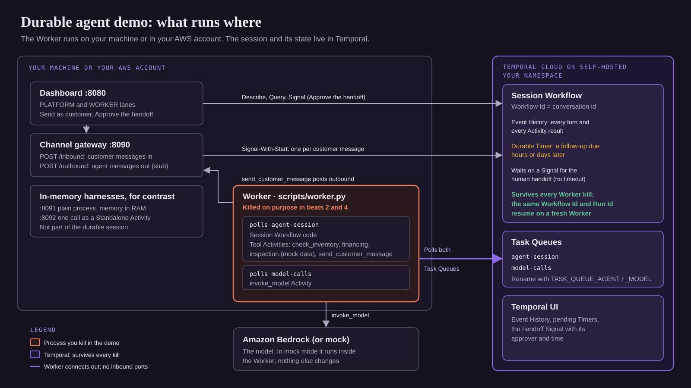 | 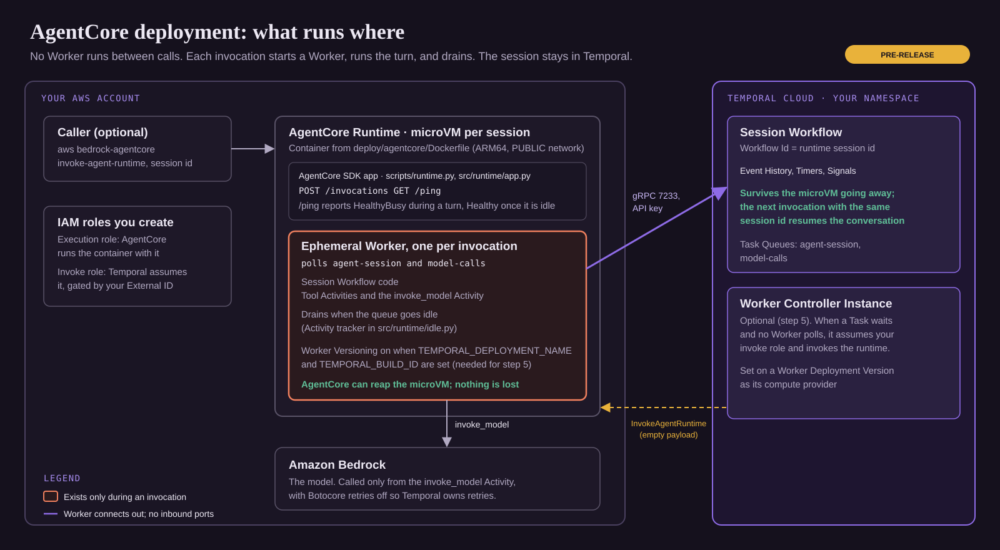 |

Select a diagram to open it full size.

The agent loop is an open source [Strands](https://strandsagents.com) agent, run through the [Strands Agents integration](https://docs.temporal.io/develop/python/integrations/strands-agents) (Public Preview). Strands is not required: to bring your own agent loop, go to [Plug in your own agent loop](#plug-in-your-own-agent-loop).

## Pick your path

| Path | You need | Time | You watch it in |
|---|---|---|---|
| **1. Local Worker, mock mode** | [uv](https://docs.astral.sh/uv/), the [Temporal CLI](https://docs.temporal.io/cli), `git`. No keys. | 5 minutes | The demo dashboard and the local Temporal UI |
| **2. Local Worker, live: Amazon Bedrock and Temporal Cloud** | Path 1, plus a Temporal Cloud Namespace and API key, and AWS credentials with Bedrock model access | 15 minutes | The dashboard and the Temporal Cloud UI |
| **3. Serverless Worker on Amazon Bedrock AgentCore Runtime** (Pre-release) | Path 2, plus Docker with `buildx`, rights to create an ECR repo, IAM roles and an AgentCore runtime, and Temporal Cloud access to the Pre-release | 45 minutes | The Temporal Cloud UI and the AWS console (AgentCore, CloudWatch) |

Start with path 1. Each path adds to the one before it, and the same code runs in all three. Paths 1 and 2 run a local Worker; path 3 moves that Worker into AgentCore Runtime.

## Contents

1. [What you will see](#what-you-will-see)
2. [How it works](#how-it-works)
3. [Path 1: Quickstart, mock mode, no keys](#quickstart-mock-mode-no-keys)
4. [Path 2: Live mode, Amazon Bedrock and Temporal Cloud](#live-mode-amazon-bedrock-and-temporal-cloud)
5. [Run the beats](#run-the-beats)
6. [Watch it in the Temporal UI](#watch-it-in-the-temporal-ui)
7. [Path 3: Run the Worker serverless on Amazon Bedrock AgentCore Runtime](#path-3-run-the-worker-on-amazon-bedrock-agentcore)
8. [Where Temporal plugs in](#where-temporal-plugs-in)
9. [Plug in your own agent loop](#plug-in-your-own-agent-loop)
10. [Patterns used](#patterns-used)
11. [Release stages](#release-stages)
12. [Configuration](#configuration)
13. [Troubleshooting](#troubleshooting)
14. [Further reading](#further-reading)
15. [Repo map](#repo-map)

## What you will see

Five beats. Each one maps to a problem you hit when you run an agent loop inside short-lived compute.

| # | Beat | The problem it answers | Run it | `beat.py` |
|---|---|---|---|---|
| 1 | **The agent session is a Workflow.** The Workflow Id is the conversation id. Event History holds every model call and tool call. | Where does the conversation live between requests? | [Beat 1](#beat-1-the-agent-session-is-a-workflow) | `3` and `4` |
| 2 | **No rehydration code after a Worker crash.** Kill the Worker mid session. A fresh Worker picks up the same Workflow with its memory. An in-memory harness, killed the same way, loses everything. | The rehydration loop you write so a function can stop and start again. | [Beat 2](#beat-2-no-rehydration-code-after-a-worker-crash) | `9 --kill` |
| 3 | **Sessions wait past 15 minutes on durable Timers.** Sessions with follow-ups due in 1, 4, 24 and 72 hours stay Running with no Worker. | A 15-minute function limit bounds how long a session can wait. | [Beat 3](#beat-3-sessions-wait-past-15-minutes-on-durable-timers) | `plan_follow_ups.py` |
| 4 | **A Timer fires while no Worker runs.** The follow-up falls due during the outage. The next Worker sends it. | Scheduled work needs a cron, a scheduler table and a reconciliation job. | [Beat 4](#beat-4-a-timer-fires-while-no-worker-runs) | `5 --kill` |
| 5 | **Retries, then a human approval parked on a Signal.** A tool fails past its retries, the model reads the failure, and the session waits for a back-office decision. | Approval loops that run for days. | [Beat 5](#beat-5-retries-then-a-human-approval-parked-on-a-signal) | `6` |

The `beat.py` column is the headless command for each beat. Code comments use the `beat.py` numbers, so `Beat 6` in a docstring is beat 5 here.

The dashboard shows two lanes. PLATFORM reads the Workflow from the Temporal Service. WORKER reads it through a Query that a Worker answers. Kill the Worker and the lanes split: the session is still Running, and nothing is lost.

| Worker up | Worker killed |
|---|---|
| 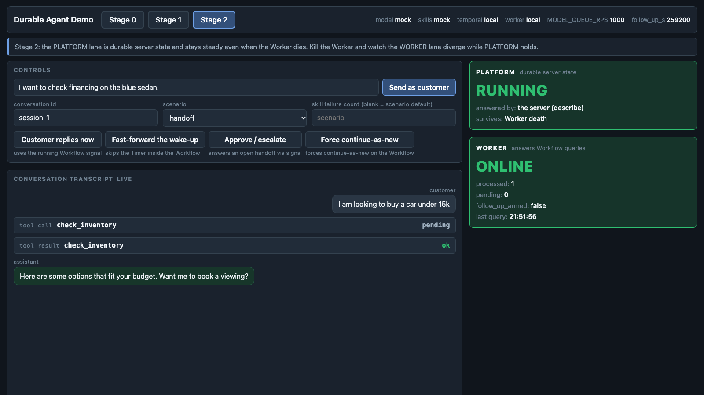 | 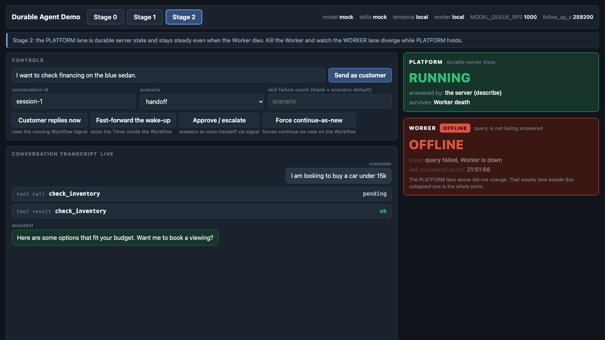 |

## How it works

**One turn.** A customer message reaches the session Workflow by Signal-With-Start. The Worker runs the Workflow code, which runs the Strands agent loop. Each model call and each tool call is an Activity, and each result lands in Event History before the next step starts.

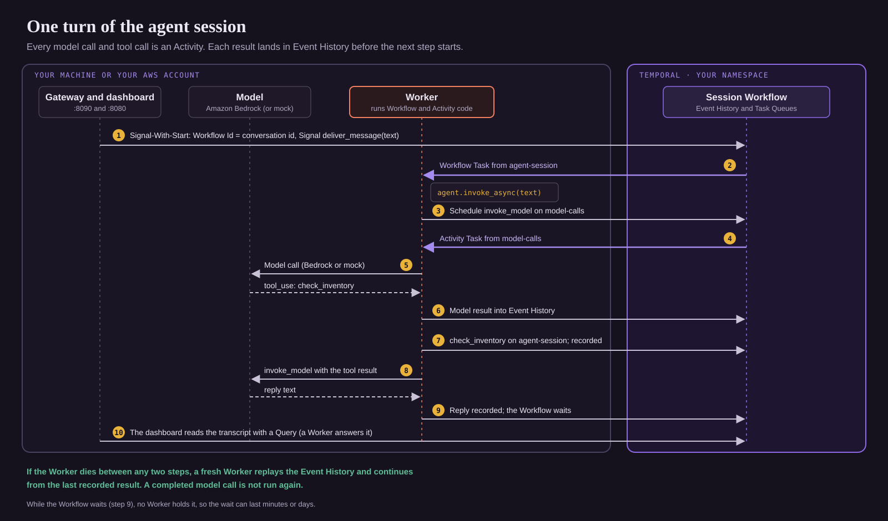

**Why a crash loses nothing.** When a Worker dies, the Workflow stays Running in Temporal. The next Worker fetches the Event History, replays the Workflow code up to the last recorded result, and continues. Completed model calls are not run again. See [Event History](https://docs.temporal.io/encyclopedia/event-history).

**Why waiting needs no Worker.** Between messages, the Workflow waits on a Signal or a durable Timer. No Worker holds it in memory. See [Timers](https://docs.temporal.io/workflow-execution/timers-delays).

**Two Task Queues.** `agent-session` carries the session Workflow and the tool Activities. `model-calls` carries the model Activity, so you can scale and rate-limit model calls on their own.

**Three adoption stages.** The same agent loop runs three ways, so you can see what each step of adoption buys:

| Stage | Code | What Temporal owns | If the process dies |
|---|---|---|---|
| 0. Plain harness | [`src/harness_plain/`](src/harness_plain/) | Nothing. State in a dict, hand-written retries. | The conversation is gone. |
| 1. One call wrapped | [`src/harness_wrapped/`](src/harness_wrapped/) | One tool runs as a [Standalone Activity](https://docs.temporal.io/standalone-activity). | That call survives. The conversation is still in a dict. |
| 2. Session is a Workflow | [`src/durable_agent/`](src/durable_agent/) | The whole session. | Nothing is lost. |

The five beats use stage 2, with stage 0 as the contrast in beat 2.

## Quickstart: mock mode, no keys

*Path 1.*

Mock mode uses a mock model, mock tools and a local Temporal dev server. Everything except token generation is real: Event History, Timers, Signals, Retry Policies, replay and Worker recovery.

**Prerequisites:** [uv](https://docs.astral.sh/uv/), the [Temporal CLI](https://docs.temporal.io/cli) 1.7 or later (`brew install temporal`), and `git`. uv installs Python and the dependencies. Optional: [`jq`](https://jqlang.org) (`brew install jq`) for the CLI checks in beats 1, 3 and 5.

### One command

Get the code first: clone the repo or unzip the archive, so you have a `temporal-durable-agent-demo` folder. Then:

```bash
cd temporal-durable-agent-demo
./scripts/preflight.sh     # optional: checks versions and proves the setup (about a minute)
./scripts/run.sh           # dev server, Worker, gateway, harnesses, dashboard
```

The first run does a `uv sync`. When you see `=== up ===`, open:

- Dashboard: <http://127.0.0.1:8080/?conversation=smoke-1>
- Temporal UI: <http://localhost:8233>

Send one message from another terminal to prove the whole path:

```bash
curl -s -X POST http://127.0.0.1:8090/inbound -H 'content-type: application/json' \
  -d '{"conversation":"smoke-1","text":"I am looking to buy a car under 15k","scenario":"happy"}'
# {"workflow_id":"smoke-1","run_id":"...","scenario":"happy"}
```

Press Ctrl-C in the `run.sh` terminal to stop everything it started. It stops the Workers first, then the dev server. The dev server keeps its state in memory, so a restart clears every session.

### Separate terminals

Use this when you want to Ctrl-C one process by hand, for example the Worker in beats 2 and 4. Run each command in its own terminal, from the repo root, after these two lines:

```bash
export PYTHONPATH="$PWD/src"
export OUTBOUND_URL="http://127.0.0.1:8090/outbound"
```

| Terminal | Command | You stop it in |
|---|---|---|
| Dev server | `temporal server start-dev --dynamic-config-value activity.enableStandalone=true --search-attribute NextFollowUpAt=Datetime` | the end |
| Worker | `uv run python scripts/worker.py` | beats 2 and 4 (then start it again) |
| Gateway | `FOLLOW_UP_SEARCH_ATTRIBUTE=on FOLLOW_UP_DELAY=30 uv run python scripts/gateway.py` | the end |
| Dashboard | `uv run uvicorn dashboard.app:app --host 127.0.0.1 --port 8080` | the end |
| Stage 0 harness | `HARNESS_PORT=8091 uv run python -m harness_plain.app` | beat 2 (then start it again) |
| Stage 1 harness | `HARNESS_PORT=8092 uv run python -m harness_wrapped.app` | optional |
| Spare | `beat.py`, `plan_follow_ups.py`, `temporal` CLI | |

The gateway builds each session's input, so `FOLLOW_UP_DELAY` on the gateway sets when a follow-up fires (here, 30 seconds). For live mode, load `.env` in every terminal first: `set -a; . ./.env; set +a`.

## Live mode: Amazon Bedrock and Temporal Cloud

*Path 2.*

Only the model and the Temporal connection change. The Worker, gateway and dashboard still run on your machine. Every setting lives in `.env`; copy [`.env.example`](.env.example) to start.

1. **Your Namespace.** Create a Temporal Cloud Namespace (or use self-hosted Temporal) and an [API key](https://docs.temporal.io/cloud/api-keys) for it.
2. **Your model.** Use AWS credentials with Bedrock access to a model, through `AWS_PROFILE` or any other source in the standard chain.
3. **Fill in `.env`:**

   ```bash
   TEMPORAL_TARGET=cloud
   TEMPORAL_ADDRESS=<region>.<cloud>.api.temporal.io:7233
   TEMPORAL_NAMESPACE=<namespace>.<account-id>
   TEMPORAL_API_KEY=<your-api-key>
   MODEL_MODE=bedrock
   AWS_REGION=us-east-1
   AWS_PROFILE=<your-aws-profile>
   BEDROCK_MODEL_ID=<model or inference profile id, for example us.anthropic.claude-haiku-4-5-20251001-v1:0>
   FOLLOW_UP_SEARCH_ATTRIBUTE=on
   ```

   The client connects through [environment configuration](https://docs.temporal.io/develop/environment-configuration), so local and Cloud differ only in these variables.
4. **Register the Search Attribute** once, for beat 3. In the Temporal Cloud UI, edit the Namespace and add a Custom Search Attribute named `NextFollowUpAt` of type `Datetime`. Or use the [`temporal cloud` CLI extension](https://docs.temporal.io/cli/command-reference/cloud/namespace#search-attribute-create) (Public Preview). It is not part of the core Temporal CLI:

   ```bash
   temporal cloud namespace search-attribute create --namespace <namespace>.<account-id> \
     --name NextFollowUpAt --type Datetime
   ```

   With [`tcld`](https://docs.temporal.io/cloud/tcld/namespace#search-attributes), the same step is `tcld namespace search-attributes add --namespace <namespace>.<account-id> --search-attribute NextFollowUpAt=Datetime`.

5. **Start the stack:**

   ```bash
   ./scripts/run.sh --cloud
   # worker up: target=cloud model=bedrock skills=mock queues=agent-session,model-calls ...
   ```

6. **Load `.env` in every other terminal** before you run `beat.py`, `plan_follow_ups.py` or the `temporal` CLI: `set -a; . ./.env; set +a`. The `temporal` CLI reads the same three `TEMPORAL_*` variables. Use the Temporal Cloud UI in place of `localhost:8233`.

To use the Anthropic API instead of Bedrock, set `MODEL_MODE=anthropic` and `ANTHROPIC_API_KEY`. To run a real model against the local dev server, run `MODEL_MODE=bedrock ./scripts/run.sh`. A missing credential stops startup with a message that names the variable.

If you share the Namespace with another copy of this demo, set `TASK_QUEUE_AGENT` and `TASK_QUEUE_MODEL` to your own names in `.env`, and use conversation ids no one else uses. Only one open Workflow Execution can use a given Workflow Id in a Namespace.

## Run the beats

Start the stack first, with `./scripts/run.sh` or the [separate terminals](#separate-terminals). For beats 2 and 4 by hand, start with the separate terminals and run beat 1 there: the dev server keeps sessions in memory, so `session-1` from a stopped `run.sh` is gone. Each beat has a hand-driven path for a live demo and a headless `beat.py` command that asserts the outcome and exits non-zero on failure. Each `beat.py` run prints its conversation id; open `http://127.0.0.1:8080/?conversation=<id>` to watch it.

The dashboard preselects the `handoff` scenario and prefills a financing message. Pick the scenario each beat names, and type the message shown.

### Beat 1: The agent session is a Workflow

1. Open <http://127.0.0.1:8080/?conversation=session-1>.
2. Set **scenario** to `happy`. Type `I am looking to buy a car under 15k` and click **Send as customer**.
3. The transcript shows the `check_inventory` tool call and the reply.

**In the Temporal UI:** open Workflow `session-1`. Its type is `SessionWorkflow` and it stays Running. Event History lists `invoke_model` on `model-calls`, `check_inventory` on `agent-session`, then `invoke_model` again. From the CLI:

```bash
temporal workflow show -w session-1 -o json | jq -r '.events[] | select(.activityTaskScheduledEventAttributes)
  | "\(.eventId) \(.activityTaskScheduledEventAttributes.activityType.name) on \(.activityTaskScheduledEventAttributes.taskQueue.name)"'
```

Headless: `uv run python scripts/beat.py 3` (inbound Signal-With-Start) and `uv run python scripts/beat.py 4` (the session parks and resumes in the same run).

### Beat 2: No rehydration code after a Worker crash

By hand, with [separate terminals](#separate-terminals):

1. **The in-memory harness.** Click **Stage 0**. Set the conversation id to `plain-1` and the scenario to `happy`, and send `I am looking to buy a car under 15k`. When the reply shows, press Ctrl-C in the stage 0 harness terminal, then start it again. The transcript is empty: the process was the state.
2. **The durable session.** Click **Stage 2** and open conversation `session-1` from beat 1. If you restarted the dev server, send beat 1's message to `session-1` again first. Press Ctrl-C in the Worker terminal. PLATFORM stays RUNNING and WORKER turns OFFLINE.
3. Start the Worker again. Send `Book an inspection for the first one`. The transcript keeps turn 1 above the new message: the new Worker replayed the conversation from Event History. With a live model, the agent books the first vehicle it listed in turn 1. The mock model gives a canned reply.

**In the Temporal UI:** `session-1` keeps the same Run Id across the crash. The next Workflow Task shows the new Worker's identity.

Headless, both lanes in one command:

```bash
uv run python scripts/beat.py 9 --kill
```

From a terminal it prints `open http://127.0.0.1:8080/?conversation=beat9-... then press Enter`. Open the URL first, so the dashboard shows the transcript, then press Enter. It kills this checkout's Worker by PID, starts a fresh one, and prints `stop it with: kill <pid>`. That replacement Worker keeps running after the beat; stop it yourself when you finish.

### Beat 3: Sessions wait past 15 minutes on durable Timers

```bash
uv run python scripts/plan_follow_ups.py      # about 50 seconds in mock mode
```

It starts four sessions (`planned-1h-...`, `planned-4h-...`, `planned-24h-...`, `planned-72h-...`). Each one asks the agent to check back later, arms a follow-up, and publishes its deadline as the `NextFollowUpAt` Search Attribute. Times print in UTC.

**In the Temporal UI:** filter the Workflow list with `NextFollowUpAt IS NOT NULL AND ExecutionStatus = "Running"` and add the `NextFollowUpAt` column. Open one session: its last event is `TimerStarted`. Stop the Worker: all four stay Running. The wait lives in Temporal, not in a process. From the CLI:

```bash
temporal workflow list --query 'NextFollowUpAt IS NOT NULL AND ExecutionStatus = "Running" AND TaskQueue = "agent-session"'
temporal workflow show -w <a planned id> -o json | jq -r '.events[-1].eventType'   # EVENT_TYPE_TIMER_STARTED
```

The 1-hour session fires an hour later. If no Worker runs then, it fires when a Worker comes back.

### Beat 4: A Timer fires while no Worker runs

Headless, which is the reliable way to time it:

```bash
FOLLOW_UP_DELAY=20 uv run python scripts/beat.py 5 --kill
```

Open the printed URL and press Enter. The session arms a 20-second follow-up, the script kills the Worker, and the Timer falls due while WORKER reads OFFLINE. A fresh Worker then sends the follow-up (about 30 seconds in all).

> **Keep `FOLLOW_UP_DELAY` at 30 or less for this beat.** Above 30 seconds, `beat.py` moves the deadline with the `fast_forward_follow_up` Signal so the beat ends in time, and Event History shows no `TimerFired`. Without the variable, `beat.py` uses 3 seconds.

By hand, with the gateway started with `FOLLOW_UP_DELAY=30` ([separate terminals](#separate-terminals)):

1. Open conversation `followup-1`, set the scenario to `deferred_follow_up`, and send `I like the cars under 15k but I need some time to think it over. Please schedule a follow-up and check back with me later.`
2. The transcript shows `follow-up armed`. Press Ctrl-C in the Worker terminal.
3. Wait more than 30 seconds, then start the Worker again. The transcript shows `follow-up fired` and the outbound message. `curl -s http://127.0.0.1:8090/outbound` lists it.

**In the Temporal UI:** `TimerStarted`, then `TimerFired` 30 seconds later, while no Worker ran. Then `invoke_model` and `send_customer_message` on the new Worker.

```bash
temporal workflow show -w followup-1 | grep Timer
```

With `run.sh` alone, `FOLLOW_UP_DELAY` defaults to three days. Use **Fast-forward the wake-up** on the dashboard to move the deadline to now with a Signal.

### Beat 5: Retries, then a human approval parked on a Signal

1. Open conversation `handoff-1` and set the scenario to `handoff`.
2. Send `Please check the status of my financing application APP-7742. I want to buy a car.`
3. `check_financing_status` fails after three attempts, and the model gets the failure as data. The mock model then tries `check_inventory` and hands off: the transcript shows `handed off to back office`. The session is parked on a Signal, with no timeout.
4. **With a live model,** it usually reports the failure and asks a question instead. Send the nudge: `I need a human. Please hand me off to your back office team to sort out my financing.`
5. Click **Approve / escalate**. The session resumes and replies.

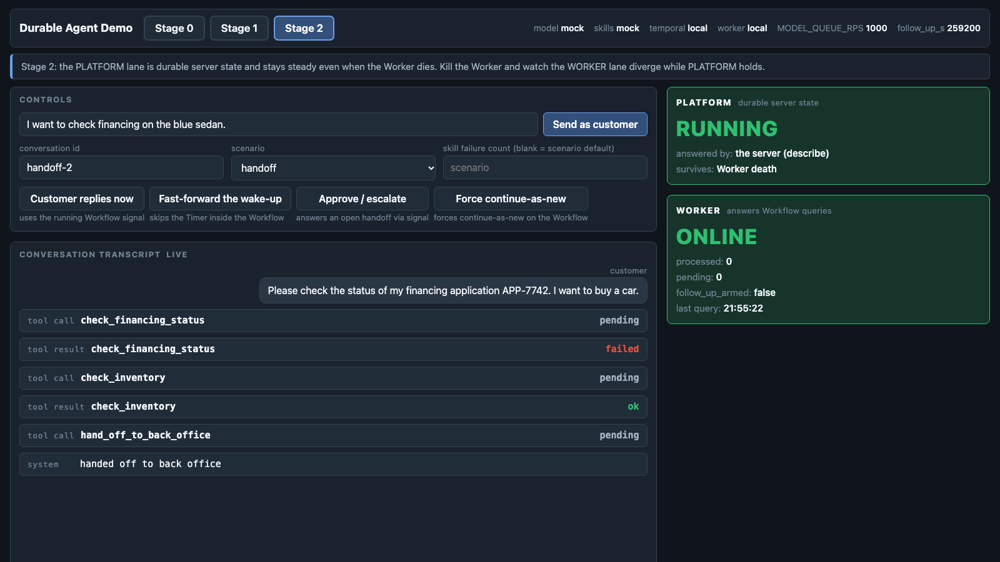

**In the Temporal UI:** one `ActivityTaskStarted` with `attempt 3` and the last failure, then `ActivityTaskFailed`. Retries are recorded on one event, not three. After you approve, `WorkflowExecutionSignaled` for `respond_handoff` carries the decision and the approver, with its time.

```bash
temporal workflow show -w handoff-1 -o json | jq -r '.events[] | select(.activityTaskStartedEventAttributes.attempt > 1)
  | "\(.eventId) attempt=\(.activityTaskStartedEventAttributes.attempt) \(.activityTaskStartedEventAttributes.lastFailure.message)"'
temporal workflow show -w handoff-1 -o json | jq -r '.events[] | select(.workflowExecutionSignaledEventAttributes.signalName=="respond_handoff")
  | "\(.eventId) \(.eventTime) \(.workflowExecutionSignaledEventAttributes.input.payloads | map(.data|@base64d) | join(" "))"'
```

Headless: `uv run python scripts/beat.py 6` (it nudges and approves on its own).

### More beats

| `beat.py` | What it proves |
|---|---|
| `1` | The stage 0 harness loses the session when killed mid tool call |
| `2` | The stage 1 Standalone Activity survives the harness kill |
| `7` | A Task Queue-wide model rate cap holds across two Workers. Start the stack with `MODEL_QUEUE_RPS=2 ./scripts/run.sh --workers 2`, then in another terminal run `MODEL_QUEUE_RPS=2 uv run python scripts/beat.py 7`. Set it in both places, so the Workers apply the cap and `beat.py` checks against it |
| `8` | Continue-As-New carries the conversation and the follow-up deadline into a fresh run |

## Watch it in the Temporal UI

Open the Temporal UI next to the dashboard: <http://localhost:8233> in path 1, the [Temporal Cloud UI](https://cloud.temporal.io) in paths 2 and 3. The screenshots below come from the local dev server; the Temporal Cloud UI shows the same pages.

| Beat | Open | What to look at |
|---|---|---|
| 1 | **Workflows**, then the session (Workflow Id = conversation id) | Type `SessionWorkflow`, status Running. **Event History** lists each `invoke_model` and tool Activity in order. |
| 2 | The same session, after you kill and restart the Worker | The Run Id does not change. The next Workflow Task shows the new Worker's identity. |
| 3 | **Workflows**, filter `NextFollowUpAt IS NOT NULL AND ExecutionStatus = "Running"` | One row per session with a planned wake-up. Open one, then **Search Attributes**: `NextFollowUpAt` holds the deadline. |
| 4 | The follow-up session, **Event History**, **Compact** | A Timer row, then `send_customer_message` run by the Worker that came back. |
| 5 | The handoff session, **Event History**, **Compact** | `check_financing_status` with Attempt 3 and its failure, then the `respond_handoff` Signal with the decision. |
| More | **Standalone Activities** | `stage1-financing-check`, Completed: one call made durable with no Workflow (`beat.py 2`). |

<details>
<summary><b>Screenshots: the planned follow-ups across sessions (beat 3)</b></summary>

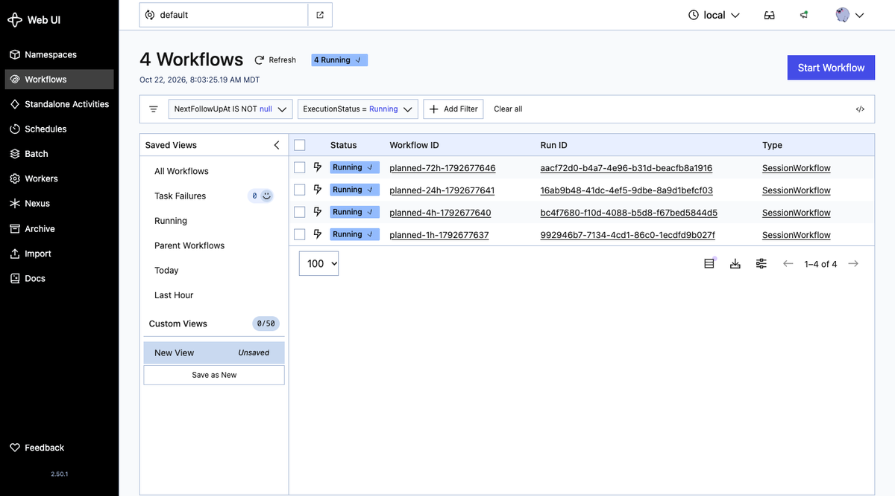

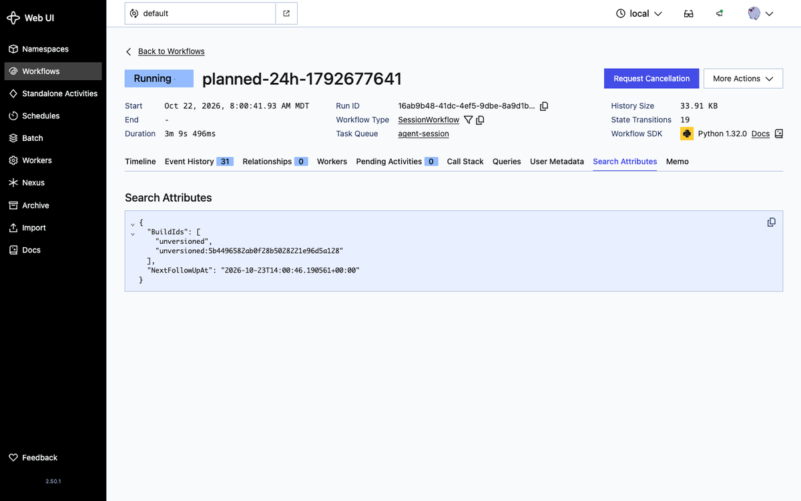
</details>

<details>
<summary><b>Screenshots: the retries and the approval in Event History (beat 5)</b></summary>

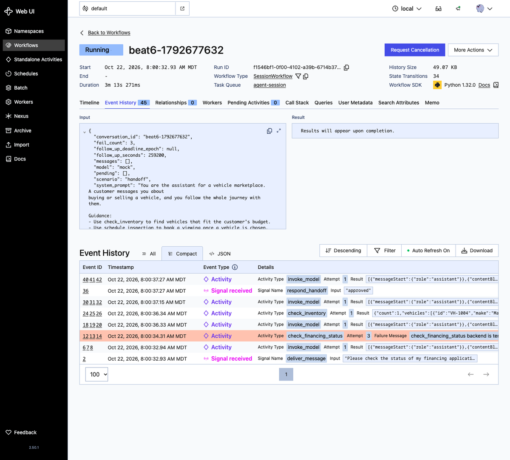

The list is newest first. Retries are recorded on one Activity row, not one row per attempt.
</details>

<details>
<summary><b>Screenshots: the follow-up Timer (beat 4) and the Standalone Activity</b></summary>

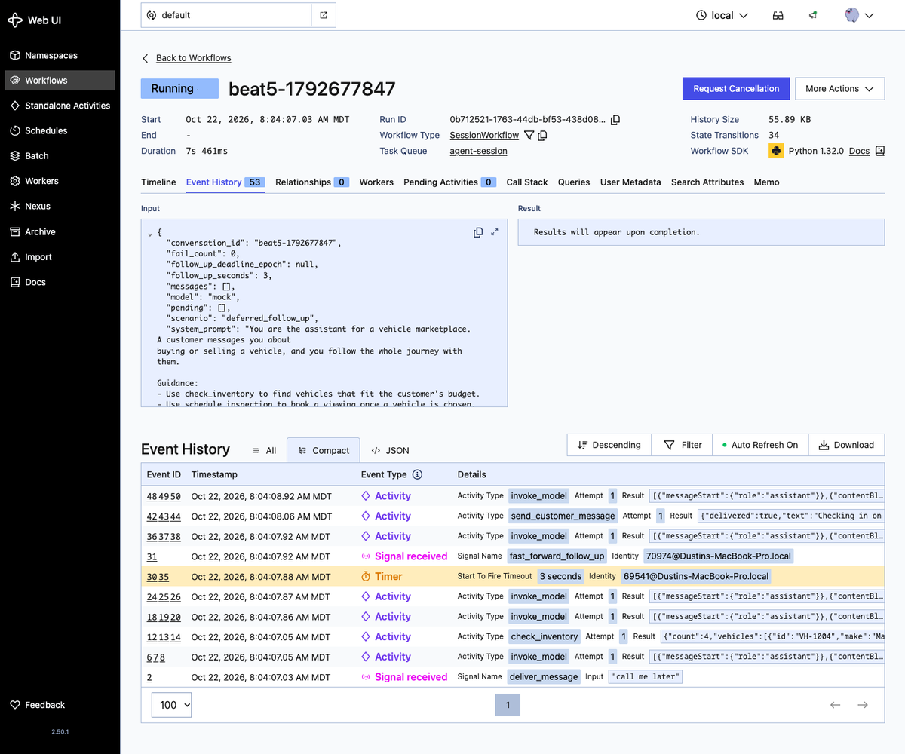

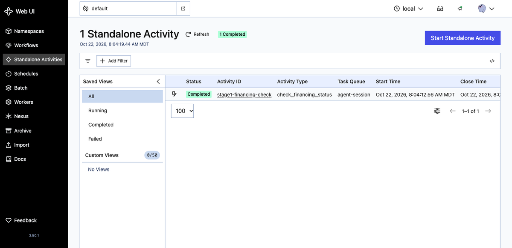
</details>

## Path 3: Run the Worker on Amazon Bedrock AgentCore

> [!IMPORTANT]
> [Serverless Workers on Amazon Bedrock AgentCore Runtime](https://docs.temporal.io/serverless-workers/agentcore) are in **Pre-release**: the APIs can change. On Temporal Cloud, request access through a support ticket or your account team.

The Worker holds no state, so it can run on compute that starts and stops. In this path the same session Workflow runs inside AgentCore Runtime, and no Worker runs between turns:

- **Each invocation starts a short-lived Worker** in the AgentCore microVM. It runs the work on the Task Queues, waits until nothing has run for an idle window (`AGENTCORE_DEBOUNCE_SECONDS`, 60 seconds by default; the steps set 15), then drains and returns.
- **The session lives in Temporal Cloud.** AgentCore can end the microVM at any time; the next invocation picks the session up from Event History.
- **Temporal can start the Worker for you.** With a compute provider on a Worker Deployment Version, Temporal's Worker Controller Instance calls `InvokeAgentRuntime` when a Task waits and no Worker polls. A durable follow-up that fires days later starts a Worker the same way.


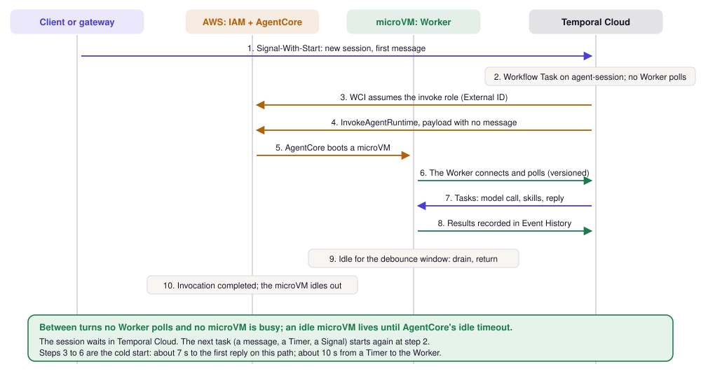

### Steps

The full commands are in [`deploy/agentcore/README.md`](deploy/agentcore/README.md). In order:

| Step | What you do | What it proves |
|---|---|---|
| 1. [Execution role](deploy/agentcore/README.md#step-1-create-the-execution-role) | Render the IAM templates for your account and create the role AgentCore runs the container as | |
| 2. [Build and push](deploy/agentcore/README.md#step-2-build-and-push-the-image) | `./deploy/agentcore/deploy.sh` builds the ARM64 image and pushes it to ECR | |
| 3. [Create the runtime](deploy/agentcore/README.md#step-3-create-the-runtime) | `create_runtime.py` creates the runtime with your Temporal Cloud connection | |
| 4. [Invoke it](deploy/agentcore/README.md#step-4-invoke-it-with-no-local-worker) | Send a turn, end the microVM with `stop-runtime-session`, send a second turn | The session survives the microVM: turn 2 remembers turn 1 |
| 5. [Let Temporal start the Worker](deploy/agentcore/README.md#step-5-optional-let-temporal-start-the-worker) | Create the invoke role, version the runtime, `serverless.sh wire`, run `verify_serverless.py` | No Worker runs until there is work |
| 6. [A follow-up across scale to zero](deploy/agentcore/README.md#step-6-optional-a-follow-up-across-scale-to-zero) | `verify_serverless.py --follow-up 90` | A Timer fires with no Worker running, and Temporal starts one |
| 7. [Watch it](deploy/agentcore/README.md#step-7-watch-it-in-the-aws-console-and-the-temporal-ui) | The AgentCore runtime page, CloudWatch Live Tail, the Temporal Cloud UI | Where each step shows up |
| 8. [Clean up](deploy/agentcore/README.md#step-8-clean-up) | Unwire, then delete the runtime, the image, the roles and the stack | |

### What you see in the AWS console and the Temporal UI

| Where | Open | What you see |
|---|---|---|
| AWS console | **Amazon Bedrock AgentCore > Agent runtime >** your runtime | Status READY, the version, network mode PUBLIC, the DEFAULT endpoint, an idle session timeout of 15 minutes |
| AWS console | **CloudWatch > Live Tail**, log group `/aws/bedrock-agentcore/runtimes/<runtime-id>-DEFAULT`, filter `Invocation` | One `Invocation completed successfully (Ns)` line each time a Worker finishes its work |
| Temporal Cloud UI | **Workflows**, Workflow Id = the session id you invoked with | The session stays Running across invocations; Event History has every turn |
| Temporal Cloud UI | **Workers > Deployments** | Your Worker Deployment and its current version while Temporal starts the Worker (step 5) |
| Temporal Cloud UI | The follow-up session, **Event History** | `TimerStarted`, about 90 seconds with nothing, `TimerFired`, then the Activities of the follow-up turn |

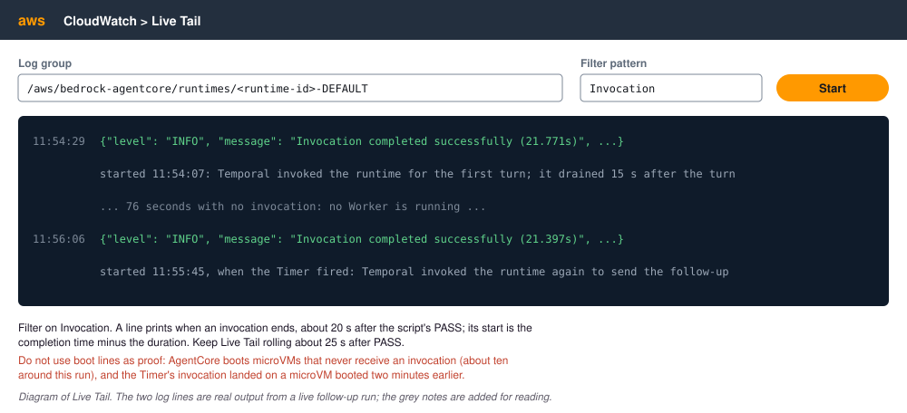

### AWS Lambda

With [Serverless Workers on AWS Lambda](https://docs.temporal.io/serverless-workers/aws-lambda) (Public Preview), Temporal invokes a Lambda function when Tasks arrive. Each invocation stays inside the 15-minute limit; the Workflow does not care, because its state is in Temporal. This repo does not include a Lambda deployment. For Python, see [the `lambda_worker` package](https://docs.temporal.io/develop/python/workers/serverless-workers/aws-lambda).

## Where Temporal plugs in

These are the places where the demo adds Temporal to an existing agent loop. Everything else is ordinary agent code.

| Where | What it does | Why it matters |
|---|---|---|
| [`TemporalAgent` in the session Workflow](src/durable_agent/workflows/session.py#L355-L366) | Builds the Strands agent inside the Workflow. Model calls go to the `model-calls` Task Queue as Activities. | Your agent loop stays the same; it becomes durable. Its `messages` are rebuilt from Event History on replay, so Event History is the conversation history. |
| [`activity_as_tool`](src/durable_agent/workflows/session.py#L316-L332) | Turns each tool Activity into a tool the agent can call, with its own timeout and Retry Policy. | Each tool call is recorded once. A crash after a tool call does not run it again. |
| [A tool that calls an Activity itself](src/durable_agent/workflows/session.py#L275-L298) | `check_financing_status` runs with [three attempts](src/domain/skills.py#L142-L156), then returns the failure to the model as data. | Retries come from the platform; the model decides what to do once they run out. |
| [`StrandsPlugin` and the model mapping](src/durable_agent/config.py#L105-L115) | Registers the model factory (mock, Anthropic or Bedrock) and the `invoke_model` Activity on the Worker. [Botocore retries are off](src/durable_agent/config.py#L88-L102) so Temporal owns them. | Switching models is configuration. The Workflow never holds credentials. |
| [The Worker, two Task Queues](src/durable_agent/worker.py#L71-L93) | One Worker per queue: `agent-session` (Workflow and tools) and `model-calls` (model). An optional [Task Queue-wide rate cap](src/durable_agent/worker.py#L61-L63) applies to model calls. | The Worker connects out and holds no state. Kill it at any point; this is the process that could run in Lambda or AgentCore. |
| [Signal-With-Start in the session client](src/durable_agent/session_client.py#L18-L40) | Starts the session if needed and delivers the message, keyed by conversation id. | No exists check, no lookup table, no lock. A request handler never rehydrates anything. |
| [The gateway's inbound handler](src/channel/gateway.py#L49-L62) | `POST /inbound` maps a channel message to Signal-With-Start. | The seam where a real channel attaches. |
| [The follow-up wait](src/durable_agent/workflows/session.py#L407-L440) | Waits for a message, a Signal that moves the deadline, or the [deadline it armed](src/durable_agent/workflows/session.py#L478-L490). | A durable Timer replaces a scheduler. The wait can outlast any 15-minute compute limit. |
| [The `respond_handoff` Signal](src/durable_agent/workflows/session.py#L191-L207) | Records the back-office decision, approver and time. The [handoff loop](src/durable_agent/workflows/session.py#L460-L476) parks on it; the [approval hook](src/durable_agent/workflows/session.py#L50-L74) raises the interrupt. | A days-long approval is a wait on a Signal. No Worker holds it. |
| [Continue-As-New](src/durable_agent/workflows/session.py#L382-L405) | When idle and Temporal suggests it, starts a fresh run with the same Workflow Id, carrying the messages and the absolute follow-up deadline. | Keeps a long session's Event History bounded. |
| [The in-memory harness, for contrast](src/harness_plain/loop.py#L32-L38) | State in a dict, [saved after each turn](src/harness_plain/loop.py#L102-L118). | This is the code you would have to make durable by hand. |

## Plug in your own agent loop

You do not need Strands. The same shape works for any agent loop, in any Temporal SDK:

- **The session is a Workflow.** Use the conversation or session id as the Workflow Id. Start and message it with Signal-With-Start.
- **Model calls and tool calls are Activities.** They retry on a Retry Policy, and their results are recorded. Turn off your model client's own retries.
- **Human input arrives as a Signal or an Update.** Use a Signal for fire-and-forget input (this demo). Use an Update when the caller needs an answer back, for example "approved, and here is the result". See [message passing](https://docs.temporal.io/encyclopedia/workflow-message-passing).
- **Context travels in headers.** Tenant ids, user ids and trace ids that are not part of the agent's input go in Temporal headers. A client interceptor writes them on start and Signal; Workflow and Activity interceptors read them and pass them on. See [Python interceptors](https://docs.temporal.io/develop/python/workers/interceptors) and the [context propagation sample](https://github.com/temporalio/samples-python/tree/main/context_propagation).
- **Large context goes to your store.** When a conversation grows past the payload limit, [External Storage](https://docs.temporal.io/develop/python/data-handling/external-storage) (Public Preview) keeps the payload in Amazon S3 and a reference in Event History.

A minimal Python sketch of the shape, with your own model and tool calls:

```python
from datetime import timedelta

from temporalio import activity, workflow


@activity.defn
async def call_model(messages: list[dict]) -> dict:
    ...  # your model client; turn its own retries off


@activity.defn
async def run_tool(name: str, args: dict) -> dict:
    ...  # your tool code


@workflow.defn
class AgentSession:
    def __init__(self) -> None:
        self.inbox: list[str] = []
        self.messages: list[dict] = []

    @workflow.signal
    def user_message(self, text: str) -> None:
        self.inbox.append(text)

    @workflow.query
    def history(self) -> list[dict]:
        return self.messages

    @workflow.run
    async def run(self, messages: list[dict]) -> None:
        self.messages = list(messages)
        while True:
            if not self.inbox and workflow.info().is_continue_as_new_suggested():
                workflow.continue_as_new(self.messages)
            # Parked here with no Worker holding it until the next message arrives.
            await workflow.wait_condition(lambda: bool(self.inbox))
            self.messages.append({"role": "user", "content": self.inbox.pop(0)})
            while True:  # your agent loop: model, tools, model
                reply = await workflow.execute_activity(
                    call_model, self.messages, start_to_close_timeout=timedelta(minutes=2)
                )
                self.messages.append(reply)
                if not reply.get("tool_calls"):
                    break
                for call in reply["tool_calls"]:
                    result = await workflow.execute_activity(
                        run_tool,
                        args=[call["name"], call["args"]],
                        start_to_close_timeout=timedelta(minutes=5),
                    )
                    self.messages.append({"role": "tool", "content": result})
```

Start it with `client.start_workflow(AgentSession.run, [], id=conversation_id, task_queue=..., start_signal="user_message", start_signal_args=[text])`.

If your framework has a Temporal integration, it does this wiring for you:

- [Strands Agents integration](https://docs.temporal.io/develop/python/integrations/strands-agents) (Python, Public Preview), used in this repo.
- [OpenAI Agents SDK integration](https://docs.temporal.io/develop/python/integrations/openai-agents) (Python, [Generally Available](https://github.com/temporalio/sdk-python/releases/tag/1.24.0)).

For TypeScript, see the [TypeScript integrations list](https://docs.temporal.io/develop/typescript/integrations) and [TypeScript interceptors](https://docs.temporal.io/develop/typescript/interceptors). Check each integration's own page for its release stage.

To stream model output to a client while the turn runs, the Strands integration can [stream agent output to clients](https://docs.temporal.io/develop/python/integrations/strands-agents#stream-agent-output-to-clients). It is part of the Public Preview integration, and this demo does not use it.

## Patterns used

Each pattern below is in the code; the link goes to its Temporal pattern page.

| Pattern | Where it is in this repo |
|---|---|
| [Entity Workflow](https://docs.temporal.io/design-patterns/entity-workflow) | One long-lived `SessionWorkflow` per conversation id |
| [Signal with Start](https://docs.temporal.io/design-patterns/signal-with-start) | [`signal_with_start`](src/durable_agent/session_client.py#L18-L40), used by the gateway and every script |
| [Updatable Timer](https://docs.temporal.io/design-patterns/updatable-timer) | [The follow-up wait](src/durable_agent/workflows/session.py#L407-L440); [`fast_forward_follow_up`](src/durable_agent/workflows/session.py#L165-L173) and [`customer_replies_now`](src/durable_agent/workflows/session.py#L155-L163) move or cancel it |
| [Approval](https://docs.temporal.io/design-patterns/approval) | [`respond_handoff`](src/durable_agent/workflows/session.py#L191-L207) carries the decision and the approver |
| [Fixed Count of Retries](https://docs.temporal.io/design-patterns/fixed-count-retries) | [Three attempts for the financing check](src/domain/skills.py#L142-L156) |
| [Continue-As-New](https://docs.temporal.io/design-patterns/continue-as-new) | [`_maybe_continue_as_new`](src/durable_agent/workflows/session.py#L382-L405) |
| [Downstream Rate Limiting](https://docs.temporal.io/design-patterns/downstream-rate-limiting) | [Task Queue-wide cap on `model-calls`](src/durable_agent/worker.py#L61-L63) (`beat.py 7`) |

**Not used here, but the next step for some agents:** [Request-Response via Updates](https://docs.temporal.io/design-patterns/request-response-via-updates). Use it when an approver or a client needs a result back from the Workflow, not only a delivery receipt.

## Release stages

Stages are from docs.temporal.io; see [product release stages](https://docs.temporal.io/evaluate/product-release-stages).

| Feature | Stage | In this repo |
|---|---|---|
| [Strands Agents integration](https://docs.temporal.io/develop/python/integrations/strands-agents) | Public Preview | The session Workflow |
| [Serverless Workers on Amazon Bedrock AgentCore Runtime](https://docs.temporal.io/serverless-workers/agentcore) | Pre-release | `deploy/agentcore/` |
| [Serverless Workers on AWS Lambda](https://docs.temporal.io/serverless-workers/aws-lambda) | Public Preview | Not included |
| [Standalone Activities](https://docs.temporal.io/standalone-activity) | Generally Available on Temporal Server 1.32 and later; operator commands are Public Preview | Stage 1 harness. GA needs [Temporal CLI 1.9.1 or later and Server 1.32 or later](https://docs.temporal.io/standalone-activity). Temporal CLI 1.7 to 1.9.0 ships Server 1.31, so its dev server needs `activity.enableStandalone=true`, which `run.sh` sets |
| [OpenAI Agents SDK integration](https://docs.temporal.io/develop/python/integrations/openai-agents) | [Generally Available](https://github.com/temporalio/sdk-python/releases/tag/1.24.0) | Not used |
| [External Storage](https://docs.temporal.io/develop/python/data-handling/external-storage) (Python) | Public Preview | Not used |
| [`temporal cloud` CLI extension](https://docs.temporal.io/cli/command-reference/cloud/namespace) | Public Preview | Optional, to register the Search Attribute in live mode |

Workflows, Activities, Signals, Queries, Timers, Signal-With-Start, Continue-As-New, Retry Policies and Search Attributes are core Temporal features.

## Configuration

All configuration is environment variables. [`.env.example`](.env.example) lists every one with a placeholder. `run.sh` loads `.env`; anything you export in your shell wins.

| Variable | Default | What it changes |
|---|---|---|
| `TEMPORAL_TARGET` | `local` | `local` uses the dev server; `cloud` uses the three variables below |
| `TEMPORAL_ADDRESS`, `TEMPORAL_NAMESPACE`, `TEMPORAL_API_KEY` | unset | Your Temporal Cloud Namespace endpoint, id and API key |
| `MODEL_MODE` | `mock` | `mock`, `bedrock` or `anthropic` |
| `AWS_REGION`, `AWS_PROFILE`, `BEDROCK_MODEL_ID` | `us-east-1`, unset, unset | Bedrock region, credentials and model; without `BEDROCK_MODEL_ID`, Strands uses its default |
| `ANTHROPIC_API_KEY`, `ANTHROPIC_MODEL_ID` | unset | For `MODEL_MODE=anthropic` |
| `SKILLS_MODE` | `mock` | `mock` returns canned tool data |
| `TASK_QUEUE_AGENT`, `TASK_QUEUE_MODEL` | `agent-session`, `model-calls` | Optional. Rename the Task Queues to run a second copy on a shared Namespace. Every process must see the same values |
| `FOLLOW_UP_DELAY` | 259200 (three days) | Seconds from arming a follow-up to firing it. `beat.py 5` uses 3 unless set |
| `FOLLOW_UP_SEARCH_ATTRIBUTE` | `off` (`run.sh` local: `on`) | Publish `NextFollowUpAt`. Register the attribute on Cloud first |
| `MODEL_QUEUE_RPS` | 1000 | Task Queue-wide cap on model calls per second (beat 7) |
| `MOCK_SKILL_LATENCY_MS`, `MOCK_MODEL_LATENCY_MS` | 4000, 2500 | Mock dwell times; long enough to Ctrl-C mid call |
| `OUTBOUND_URL` | gateway stub | Where `send_customer_message` posts |
| `TEMPORAL_IDENTITY` | SDK default | Worker and client identity in the Temporal UI |
| `RUNTIME_HOST`, `WORKER_MODE` | `local` | `agentcore` settings for the serverless runtime and the dashboard lane labels |
| `TEMPORAL_DEPLOYMENT_NAME`, `TEMPORAL_BUILD_ID`, `AGENTCORE_DEBOUNCE_SECONDS` | unset | AgentCore runtime only; see [`deploy/agentcore/`](deploy/agentcore/README.md) |

Ports: dashboard 8080, gateway 8090, harnesses 8091 and 8092, dev server 7233, Temporal UI 8233.

## Troubleshooting

- **A beat hangs with no reply.** No Worker polls your Task Queue. Check with `temporal task-queue describe --task-queue agent-session`. If you set `TASK_QUEUE_AGENT` and `TASK_QUEUE_MODEL`, load `.env` in that terminal too; without them, `beat.py` uses the default queue names.
- **Another Worker picks up your sessions.** A stray Worker from an earlier run, or another copy of the demo on the same Namespace, polls the same Task Queue. List pollers with `temporal task-queue describe`. Stop the stray one, or give your copy its own `TASK_QUEUE_*` names. `beat.py --kill` stops only Workers started from this checkout.
- **Dead Workers stay in the poller list for a few minutes.** The list keeps a Worker for 2 to 5 minutes after it dies, so the dashboard's poller count can read high. Read the last access time, not the count.
- **The resume after a kill takes about 15 seconds.** When you kill the Worker right after a turn, the session's next Workflow Task waits for its [sticky queue](https://docs.temporal.io/sticky-execution) to time out before another Worker takes it. After a longer outage it resumes in about 5 seconds.
- **`failed reaching server: context deadline exceeded`.** A transient CLI error against Temporal Cloud. Run the command again.
- **"No messages yet" while the Worker is down.** The transcript comes from a Query, which a Worker answers. The dashboard shows only what it cached while the Worker was up, so open a session before you kill the Worker. Show seeded sessions (beat 3) in the Temporal UI.
- **The replacement Worker keeps running.** `beat.py --kill` starts a Worker that `run.sh` does not own. Ctrl-C on `run.sh` does not stop it; run the `kill <pid>` that `beat.py` printed.
- **The `tool call` row reads `pending`.** Its outcome is on the `tool result` row below it.

## Further reading

Docs pages are kept current. Blog posts and articles show their publish date.

**Durable agents with Temporal**

- [Strands Agents integration](https://docs.temporal.io/develop/python/integrations/strands-agents) (docs, Public Preview): the plugin this repo uses.
- [Durable agent with MCP and Activity-backed tools, using the Strands Agents SDK](https://docs.temporal.io/ai/cookbook/strands-agents-python) (cookbook).
- [Better together: the durability layer for your AWS agentic stack](https://temporal.io/blog/the-durability-layer-for-your-aws-agentic-stack) (Temporal blog, August 20, 2026): a Strands agent on Bedrock and Lambda that resumes after a crash.
- [Temporal Agent Harness: an early look at durable agent infrastructure](https://temporal.io/blog/temporal-agent-harness-durable-agent-infrastructure) (Temporal blog, August 20, 2026; earlier than Public Preview).

**Serverless Workers and AgentCore**

- [Run durable AI agents on Amazon Bedrock AgentCore with Temporal Serverless Workers](https://temporal.io/blog/amazon-bedrock-agentcore-with-temporal-serverless-workers) (Temporal blog, September 21, 2026).
- [Build a durable agent on Amazon Bedrock AgentCore](https://docs.temporal.io/guides/durable-agent-on-agentcore) (docs guide) and its [Python sample](https://github.com/temporalio/samples-python/tree/main/bedrock_agentcore/strands_agent).
- [Serverless Workers on Amazon Bedrock AgentCore Runtime](https://docs.temporal.io/serverless-workers/agentcore) (docs, Pre-release): Worker Versioning, the runtime session lifecycle and autoscaling.
- [Introducing Temporal Serverless Workers: deploy Temporal Workers to AWS Lambda](https://temporal.io/blog/introducing-temporal-serverless-workers-deploy-temporal-workers-to-aws-lambda) (Temporal blog, updated July 17, 2026).
- [How Temporal uses Amazon Bedrock AgentCore to create robust AI systems](https://aws.amazon.com/blogs/apn/how-temporal-uses-amazon-bedrock-agentcore-to-create-robust-ai-systems/) (AWS Partner Network blog, April 27, 2026).
- [Amazon Bedrock AgentCore Runtime](https://docs.aws.amazon.com/bedrock-agentcore/latest/devguide/agents-tools-runtime.html) (AWS docs).

**Temporal concepts used here**

- [Event History](https://docs.temporal.io/encyclopedia/event-history), [Timers](https://docs.temporal.io/workflow-execution/timers-delays), [message passing](https://docs.temporal.io/encyclopedia/workflow-message-passing), [Search Attributes](https://docs.temporal.io/search-attribute), [Worker Versioning](https://docs.temporal.io/worker-versioning) and [Standalone Activities](https://docs.temporal.io/standalone-activity).
- [Announcing new Temporal capabilities from Replay 2026](https://temporal.io/blog/replay-2026-product-announcements) (Temporal blog, May 6, 2026). Release stages have moved since; the table in [Release stages](#release-stages) is current.

## Repo map

| Path | What it is |
|---|---|
| [`src/durable_agent/`](src/durable_agent/) | Stage 2: the [session Workflow](src/durable_agent/workflows/session.py), [Worker](src/durable_agent/worker.py), [config and model mapping](src/durable_agent/config.py), [session client](src/durable_agent/session_client.py) |
| [`src/harness_plain/`](src/harness_plain/), [`src/harness_wrapped/`](src/harness_wrapped/) | Stages 0 and 1, the in-memory contrast |
| [`src/channel/gateway.py`](src/channel/gateway.py) | `POST /inbound` (Signal-With-Start) and the `/outbound` stub |
| [`src/domain/`](src/domain/) | Scenarios, prompt, tools (skills), mock model, tunables |
| [`src/dashboard/`](src/dashboard/) | The two-lane dashboard (FastAPI and one HTML file) |
| [`src/runtime/`](src/runtime/) | The AgentCore runtime app and drain on idle |
| [`scripts/`](scripts/) | `run.sh`, `preflight.sh`, `worker.py`, `gateway.py`, `beat.py`, `plan_follow_ups.py`, `verify_serverless.py`, `check_generic.sh` |
| [`datasets/`](datasets/) | Scenario profiles: `happy`, `deferred_follow_up`, `handoff` |
| [`deploy/agentcore/`](deploy/agentcore/README.md) | AgentCore deployment (Pre-release) |
| [`docs/`](docs/) | Diagrams and dashboard screenshots |
| [`tests/offline/`](tests/offline/) | The offline suite: `uv sync --extra dev && uv run pytest` (no keys, no network; it starts its own dev server) |

The demo's domain is a used-car marketplace assistant. Only the prompt, the tools and the scenarios know that; the durable parts do not.

## License

MIT. See [LICENSE](LICENSE).
