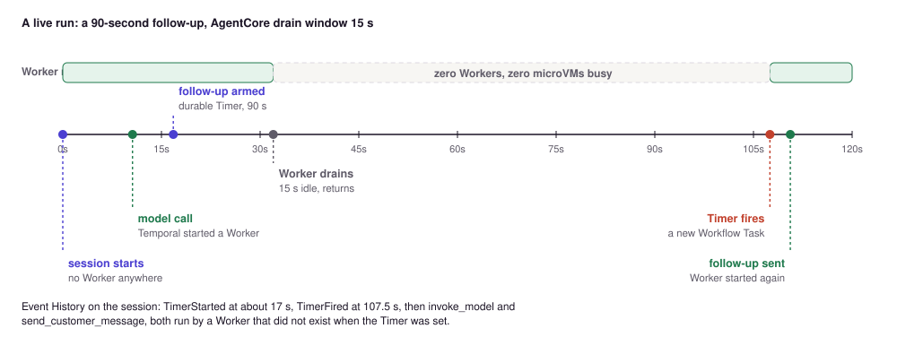
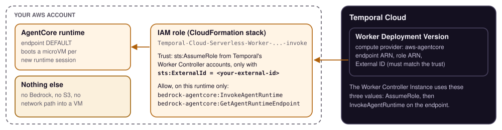

# Run the Worker on Amazon Bedrock AgentCore Runtime

> **Release stage: Pre-release.** [Serverless Workers on Amazon Bedrock AgentCore Runtime](https://docs.temporal.io/serverless-workers/agentcore)
> are in Pre-release, and their APIs may change in backwards-incompatible ways. On Temporal Cloud,
> [request access](https://docs.temporal.io/production-deployment/worker-deployments/serverless-workers)
> through a support ticket or your account team.

This folder hosts the same session Workflow inside AgentCore Runtime. No Worker runs between
calls. Each invocation starts a short-lived Worker in the AgentCore microVM, runs the turn, and
drains. The session and its state stay in Temporal Cloud, so AgentCore can reap the idle microVM
and the next invocation resumes the same conversation.

You can skip this folder entirely. The [main README](../../README.md) runs everything on your
machine.

## Contents

1. [How it works](#how-it-works)
2. [What you need](#what-you-need)
3. [Step 1: Create the execution role](#step-1-create-the-execution-role)
4. [Step 2: Build and push the image](#step-2-build-and-push-the-image)
5. [Step 3: Create the runtime](#step-3-create-the-runtime)
6. [Step 4: Invoke it with no local Worker](#step-4-invoke-it-with-no-local-worker)
7. [Step 5 (optional): Let Temporal start the Worker](#step-5-optional-let-temporal-start-the-worker)
8. [Step 6 (optional): A follow-up across scale to zero](#step-6-optional-a-follow-up-across-scale-to-zero)
9. [Step 7: Watch it in the AWS console and the Temporal UI](#step-7-watch-it-in-the-aws-console-and-the-temporal-ui)
10. [Step 8: Clean up](#step-8-clean-up)
11. [Files in this folder](#files-in-this-folder)
12. [Known limits](#known-limits)

## How it works


- **The container** ([`Dockerfile`](Dockerfile)) runs [`scripts/runtime.py`](../../scripts/runtime.py).
  It serves the AgentCore contract (`POST /invocations`, `GET /ping` on port 8080) through the
  AgentCore SDK app in [`src/runtime/app.py`](../../src/runtime/app.py).
- **Each invocation** starts an ephemeral Worker on both Task Queues. With a message in the
  payload, it delivers one turn by Signal-With-Start and returns the reply. With an empty payload
  (the path Temporal uses), it polls until the queue is idle, then drains.
- **The runtime session id is the Workflow Id.** AgentCore requires a session id of at least 33
  characters. A later invocation with the same id resumes the same conversation.
- **Drain on idle.** [`src/runtime/idle.py`](../../src/runtime/idle.py) holds an Activity tracker
  interceptor. It sees every model call and tool call, so the Worker does not stop mid turn.
  `/ping` reports `HealthyBusy` while a turn runs and `Healthy` once the work is in Temporal.
- **Network mode is `PUBLIC`.** The container reaches Temporal Cloud on port 7233 over the
  managed outbound path, with no VPC or NAT. Choose `VPC` mode only if your policy requires it;
  it then needs private subnets, a NAT gateway and an egress rule for `7233/tcp`.

## What you need

- An AWS account where you can use Amazon Bedrock, Amazon ECR and AgentCore Runtime. An
  organization Service Control Policy that denies `ecr` or `bedrock-agentcore` blocks the deploy.
- Bedrock model access for the model you pick. Strands calls the Bedrock ConverseStream API; for
  Anthropic models, submit the Anthropic use-case form in the Bedrock console first.
- Docker with `buildx` (the image is `linux/arm64`), the AWS CLI, `uv` and [`jq`](https://jqlang.org) (`brew install jq`).
- A Temporal Cloud Namespace on AWS and an API key: `TEMPORAL_ADDRESS`, `TEMPORAL_NAMESPACE`,
  `TEMPORAL_API_KEY`. Put them in the repo `.env` (see [`.env.example`](../../.env.example)).

## Step 1: Create the execution role

AgentCore assumes this role to run the container. The repo holds the trust policy and the
permissions as templates with the tokens `PARTITION`, `REGION` and `ACCOUNT_ID`. Render them for
your account:

```bash
export AWS_REGION=us-east-1
deploy/agentcore/bin/render-iam.sh        # writes deploy/agentcore/out/*.json (gitignored)
```

Create the role from `out/iam-execution-role-trust.json` and attach
`out/iam-execution-role-permissions.json`. For example:

```bash
aws iam create-role --role-name DurableAgentDemoExecution \
  --assume-role-policy-document file://deploy/agentcore/out/iam-execution-role-trust.json
aws iam put-role-policy --role-name DurableAgentDemoExecution --policy-name runtime \
  --policy-document file://deploy/agentcore/out/iam-execution-role-permissions.json
export EXECUTION_ROLE_ARN="$(aws iam get-role --role-name DurableAgentDemoExecution --query Role.Arn --output text)"
```

Give whoever invokes the runtime the permissions in `out/iam-invoke-policy.json`.

## Step 2: Build and push the image

```bash
./deploy/agentcore/deploy.sh   # creates the ECR repo if needed, builds ARM64, pushes, prints IMAGE_URI
```

## Step 3: Create the runtime

```bash
set -a; . ./.env; set +a       # TEMPORAL_ADDRESS, TEMPORAL_NAMESPACE, TEMPORAL_API_KEY
export MODEL_MODE=bedrock BEDROCK_MODEL_ID=<a Bedrock model or inference profile id you can use>
export AGENTCORE_DEBOUNCE_SECONDS=15   # the Worker drains after 15 idle seconds (default 60)
IMAGE_URI=<from step 2> uv run python deploy/agentcore/create_runtime.py
# prints agentRuntimeArn
```

Wait until the runtime is READY (about a minute):

```bash
aws bedrock-agentcore-control get-agent-runtime --region "$AWS_REGION" \
  --agent-runtime-id <runtime id> --query status --output text      # READY
```

The runtime uses a 15-minute idle timeout and an 8-hour maximum lifetime. Keep the API key in
plain env for a test only; for anything longer, inject it from AWS Secrets Manager (the
permissions template has an optional statement for it).

## Step 4: Invoke it with no local Worker

```bash
ARN=<agentRuntimeArn from step 3>
SID=session-$(date +%s)-$(uuidgen | tr A-Z a-z | cut -c1-12)   # 33 characters or more; reuse it across turns
aws bedrock-agentcore invoke-agent-runtime --region "$AWS_REGION" \
  --agent-runtime-arn "$ARN" --runtime-session-id "$SID" \
  --cli-binary-format raw-in-base64-out \
  --payload '{"prompt":"I am looking to buy a car under 15k","scenario":"happy"}' \
  --query statusCode --output text out.json && jq -r .response out.json
```

Expect `200` and a reply that lists three vehicles under $15k, in about 10 to 15 seconds on a cold runtime. There is no Worker on your machine: AgentCore started one in the microVM, it called Bedrock, and the session is now in Temporal Cloud.

Invoke again with the same `SID` and a follow-up such as "Book an inspection for the first one". The
reply knows the first turn. To prove the microVM went away between turns, stop the session first:

```bash
aws bedrock-agentcore stop-runtime-session --region "$AWS_REGION" \
  --agent-runtime-arn "$ARN" --runtime-session-id "$SID"
```

The next invoke starts a fresh microVM, and the conversation continues. In the Temporal UI, the
Workflow Id is the value of `SID`.

## Step 5 (optional): Let Temporal start the Worker

With a compute provider on a Worker Deployment Version, Temporal's Worker Controller Instance
invokes the runtime when a Task waits and no Worker polls. You then never call
`invoke-agent-runtime` yourself. See
[how Serverless invocation works](https://docs.temporal.io/serverless-workers#how-invocation-works).

1. **Invoke role.** The role Temporal Cloud assumes to call the runtime. The script downloads
   [Temporal's CloudFormation template](https://docs.temporal.io/production-deployment/worker-deployments/serverless-workers/agentcore)
   and deploys it. The External ID is a value you choose (5 to 45 characters); the same value
   goes to the Worker Deployment Version.

   ```bash
   deploy/agentcore/bin/mk-invoke-role.sh temporal-agentcore-invoke <external-id> "<runtime-arn>*"
   ```

2. **Versioned runtime.** Serverless Workers need Worker Versioning. This sets
   `TEMPORAL_DEPLOYMENT_NAME` and `TEMPORAL_BUILD_ID` on the live runtime, with no image rebuild
   ([`config.worker_deployment_config()`](../../src/durable_agent/config.py#L118) reads them):

   ```bash
   RUNTIME_ID=<your runtime id> DEPLOYMENT_NAME=durable-agent-demo BUILD_ID=v1 \
     uv run python deploy/agentcore/set_runtime_versioning.py
   ```

3. **Compute provider on the version, then prove it.**

   ```bash
   export RUNTIME_ID=<your runtime id> EXTERNAL_ID=<external-id> INVOKE_STACK=temporal-agentcore-invoke
   deploy/agentcore/serverless.sh wire
   uv run python scripts/verify_serverless.py "I am looking for an SUV under 25k"
   ```

   Expected output, with nothing on your machine polling:

   ```text
   [  0.1s] Worker Controller Instance workflow is present (Temporal is driving the invoke)
   [  6.6s] REPLY (a Worker ran inside AgentCore, started by Temporal):
   ...
   PASS: the turn completed with no local Worker.
   ```

   The first line only shows that the version is wired. The proof is the reply with no local
   Worker running.

4. **Turn it off** when you go back to the local beats. A current version routes the
   `agent-session` queue to versioned Workers only, so an unversioned local Worker gets no new
   sessions while it is wired.

   ```bash
   deploy/agentcore/serverless.sh unwire
   RUNTIME_ID=<your runtime id> uv run python deploy/agentcore/set_runtime_versioning.py --clear
   ```

   After a run, the version lists pollers for a few minutes and does not delete. Rerun
   `serverless.sh unwire` once they age out.

## Step 6 (optional): A follow-up across scale to zero

With the version still wired (step 5), start a session whose customer asks to be followed up in
90 seconds. Nothing invokes the runtime by hand:

```bash
uv run python scripts/verify_serverless.py --follow-up 90
```

Expected output (a live run):

```text
session id (workflow id): serverless-follow-up-1792679586   follow-up in 90s
starting session with NO local worker and NO manual invoke...

[  0.1s] activity: invoke_model
[  3.2s] activity: check_inventory
[  6.3s] activity: invoke_model
[  9.4s] follow-up armed: a durable Timer. The Worker drains when idle; nothing runs until the Timer fires.
[ 99.5s] Timer fired: Temporal starts a Worker in AgentCore again
[108.9s] activity: invoke_model
[108.9s] activity: send_customer_message

PASS: the follow-up was sent by a Worker Temporal started after the drain (109s).
```

What happened: Temporal started a Worker for the first turn. The agent armed a follow-up, a
durable Timer in the Workflow. The Worker drained after its idle window, and no Worker ran. When the
Timer fired, Temporal invoked the runtime again, and a new Worker sent the follow-up. That is a
scheduler and a wake-up call, replaced by a Timer.



Before you start this step, wait for the previous run's Worker to drain (its `Invocation completed`
line in CloudWatch, step 7). Otherwise the still-polling Worker takes the new session, and Temporal
does not need to start one.

## Step 7: Watch it in the AWS console and the Temporal UI

Open these side by side while you run steps 4 to 6.

**In the AWS console**

1. **Amazon Bedrock AgentCore > Agent runtime >** `durable_agent_demo`. Check Status `READY`, the
   version (it goes up by one each time `set_runtime_versioning.py` runs), network mode `PUBLIC`,
   and the `DEFAULT` endpoint. The lifecycle settings show the 15-minute idle session timeout and
   the 8-hour maximum lifetime.
2. **CloudWatch > Live Tail.** Pick the log group
   `/aws/bedrock-agentcore/runtimes/<runtime-id>-DEFAULT`, set the filter pattern to
   `Invocation`, and start. Each line is one Worker that finished its work:

   ```text
   {"level": "INFO", "message": "Invocation completed successfully (21.771s)", ...}
   ```

   A line prints when an invocation ends, so in step 6 the second line arrives about 20 seconds
   after the script's PASS. Its start time is the completion time minus the duration: when the
   Timer fired. Keep Live Tail running until it shows.
3. **CloudFormation > Stacks >** the invoke-role stack from step 5. **Outputs** has the role ARN
   that the Worker Deployment Version uses. **IAM > Roles** shows its trust policy: Temporal's
   accounts, only with your External ID.


> [!TIP]
> Use the `Invocation` lines, not the container start lines, as your evidence. AgentCore can start
> microVMs that never receive an invocation, so a start line alone does not mean Temporal started a
> Worker.

**In the Temporal Cloud UI**

1. **Workflows**, then the Workflow whose Id is your `SID` (step 4). It stays Running. After
   `stop-runtime-session` and turn 2, it has the same Run Id and a second `deliver_message` Signal
   in Event History.
2. **Workers > Deployments.** While wired (step 5), `durable-agent-demo` with its current version.
3. The step 6 session (`serverless-follow-up-...`), **Event History**: `TimerStarted`, about 90
   seconds with no events, `TimerFired`, then `invoke_model` and `send_customer_message`. A Workflow
   Task follows the Timer by about 10 seconds: the time to start a Worker in AgentCore.



## Step 8: Clean up

1. **Unwire** (step 5, item 4). Then delete what you created:

   ```bash
   aws bedrock-agentcore-control delete-agent-runtime --region "$AWS_REGION" --agent-runtime-id <runtime id>
   aws ecr delete-repository --region "$AWS_REGION" --repository-name durable-agent-demo --force
   aws cloudformation delete-stack --region "$AWS_REGION" --stack-name temporal-agentcore-invoke
   aws iam delete-role-policy --role-name DurableAgentDemoExecution --policy-name runtime
   aws iam delete-role --role-name DurableAgentDemoExecution
   ```

2. **Close the sessions** in your Namespace. Each session is a Running Workflow until you close it:

   ```bash
   temporal workflow terminate --query 'WorkflowType="SessionWorkflow" AND ExecutionStatus="Running"' \
     --reason "demo clean-up" --yes
   ```

## Files in this folder

| File | What it does |
|---|---|
| [`Dockerfile`](Dockerfile) | ARM64 image that runs `scripts/runtime.py` |
| [`deploy.sh`](deploy.sh) | Creates the ECR repo, builds, pushes, prints the next command |
| [`create_runtime.py`](create_runtime.py) | `CreateAgentRuntime` with `PUBLIC` network mode and the Temporal env |
| [`iam-execution-role-trust.json`](iam-execution-role-trust.json), [`iam-execution-role-permissions.json`](iam-execution-role-permissions.json) | Execution role templates |
| [`iam-invoke-policy.json`](iam-invoke-policy.json) | Lets a caller invoke and stop runtime sessions |
| [`bin/render-iam.sh`](bin/render-iam.sh) | Fills the templates for your account into `out/` |
| [`bin/mk-invoke-role.sh`](bin/mk-invoke-role.sh) | Deploys Temporal's invoke-role template |
| [`set_runtime_versioning.py`](set_runtime_versioning.py) | Turns Worker Versioning on or off on the runtime |
| [`serverless.sh`](serverless.sh) | `status`, `wire`, `bootstrap`, `unwire` for the compute provider |

## Known limits

- **Sessions started on AgentCore stay on the image they started on.** If you change the session
  Workflow code, rebuild the image and use new session ids. A Worker that runs different Workflow
  code than the one that started a session can fail to replay it.
- **The `DEFAULT` endpoint is for demos.** Temporal's docs warn against wiring a live Worker
  Deployment Version to `DEFAULT`, because the endpoint moves to new code. In production, use one
  named endpoint per Worker Deployment Version, pinned to a runtime version. See
  [Worker Versioning on AgentCore](https://docs.temporal.io/serverless-workers/agentcore#worker-versioning).

- **First call to a cold runtime.** The first invocation can return a 500 on the response path
  while the microVM starts, because the app waits for the reply. The turn is durable either way;
  the next invocation returns it.
- **Dashboard lanes.** A Workflow Query needs a running Worker. With no persistent Worker, the
  dashboard's WORKER lane only reads during an invocation. For the dashboard beats, run a local
  Worker (`scripts/worker.py`).
- **Environment variable field.** `create_runtime.py` passes the container env in
  `environmentVariables`. If your AgentCore API version rejects it, inject the `TEMPORAL_*`
  values through Secrets Manager or the runtime configuration.
